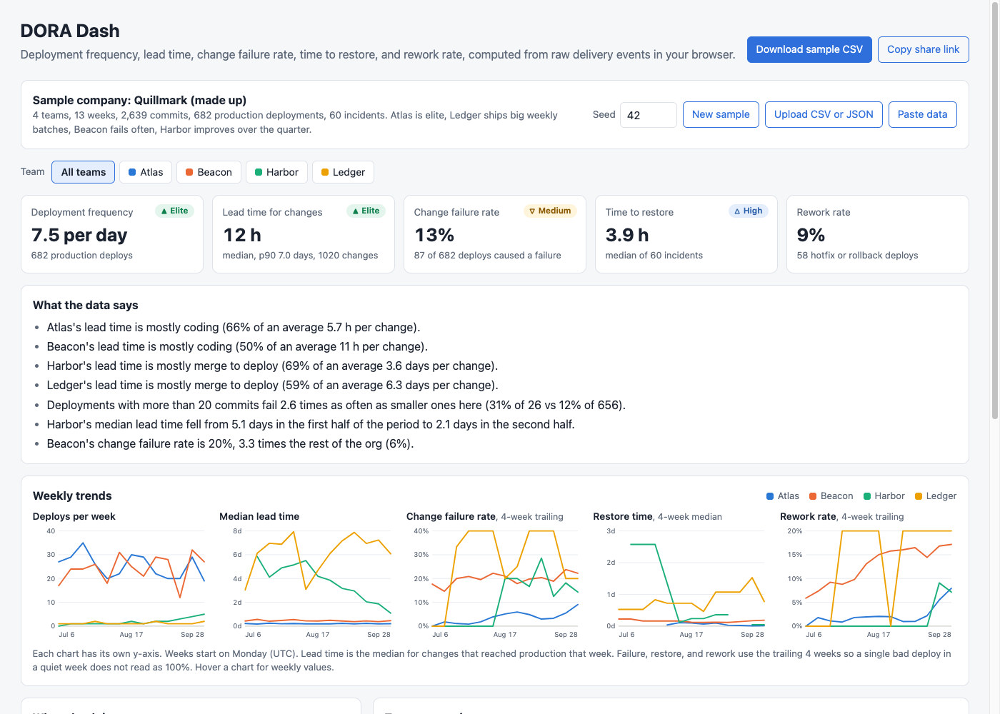

# DORA Dash

A browser dashboard that computes the four DORA delivery metrics (deployment frequency, lead time for changes, change failure rate, time to restore service) plus rework rate from raw delivery events: commits, pull requests, deployments, and incidents. It splits lead time into coding, review wait, review, and merge to deploy, and writes plain-sentence findings only when the data backs them. It ships with a seeded sample company and a script that builds the input file from the GitHub API.



## Why

Most teams that "track DORA" read four numbers off a vendor dashboard and cannot say how they were computed. The definitions matter. Is lead time measured from the first commit or the merge? Does a hotfix count as a failure? Is restore time a mean that one long outage can wreck? Two tools can give the same team an "elite" and a "medium" from the same data.

This app keeps the math in one small file with the definitions written next to the code, works from an export you can inspect, and shows where the time goes, which is the part a team can act on. In the sample data, Ledger's median lead time is 7 days, and 59% of it is merged code waiting for the weekly release train, not slow engineers.

## The sample company

Quillmark is made up: 4 teams, 13 weeks from 6 July 2026, about 2,600 commits, 1,000 PRs, 680 production deployments, and 60 incidents. Each team has a different shape:

| Team | Story | Deploys | Median lead time | Failure rate | Restore |
|---|---|---|---|---|---|
| Atlas | Small PRs, every merge ships | 3.6 per day | 4.9 h | 5% | 42 min |
| Beacon | Ships every merge, but 1 in 5 deploys breaks something | 3.5 per day | 11 h | 20% | 3.9 h |
| Harbor | Moves from weekly to daily releases over the quarter | 1.8 per week | 3.2 days | 13% | 5.7 h |
| Ledger | Weekly release train, long review queue | 1.2 per week | 7.0 days | 31% | 17 h |

With seed 42 the app finds, among others: "Deployments with more than 20 commits fail 2.6 times as often as smaller ones here (31% of 26 vs 12% of 656)" and "Harbor's median lead time fell from 5.1 days in the first half of the period to 2.1 days in the second half." Change the seed for a different draw. `data/sample-events.csv` is the seed 42 file.

## Metric definitions

All of these live as comments at the top of `src/dora.js`.

- **Production deployment:** a deployment with `env` of production. Staging is ignored everywhere.
- **Change:** one pull request and its commits. A commit with no PR is its own change.
- **Lead time for changes:** first commit of a change to the first production deployment containing any of its commits. Median and p90.
- **Deployment frequency:** production deployments per week over the whole period.
- **Change failure rate:** failed production deployments over all production deployments. A deployment failed if an incident names it, its status is `failed` or `rolled_back`, or a later hotfix or rollback deployment names it.
- **Time to restore:** incident resolved time minus start time, median. Incidents not caused by a deployment count here but not in failure rate.
- **Rework rate:** hotfix and rollback deployments as a share of production deployments.
- **Lead time breakdown:** coding (first commit to PR opened), review wait (opened to first review), review (first review to merge), merge to deploy. Boundaries are clamped to stay in order and inside the change's lead time, so the four parts always sum to the total.

## Performance bands (approximate)

Adapted from the DORA State of DevOps reports (2021 to 2023). The reports derive these from survey clusters, and the edges move year to year. Use them as a rough yardstick.

| Metric | Elite | High | Medium | Low |
|---|---|---|---|---|
| Deployment frequency | daily or more | weekly or more | monthly or more | less than monthly |
| Lead time (median) | under 1 day | under 1 week | under 30 days | 30 days or more |
| Change failure rate | 5% or less | 10% or less | 15% or less | above 15% |
| Time to restore (median) | under 1 hour | under 1 day | under 1 week | 1 week or more |

Rework rate has no published bands, so the app shows it without one.

## Insights

Each finding is a rule with a minimum sample and a minimum effect. If either is not met, the rule stays quiet.

| Finding | Fires when |
|---|---|
| "X's lead time is mostly review wait (62%)" | One stage holds 50% or more of the team's average lead time, with at least 10 changes |
| "Deployments with more than 20 commits fail N times as often" | At least 10 deployments on each side of 20 commits, and a ratio of 1.5 or more |
| "X's median lead time fell from A to B" | At least 10 changes in each half of the period, and a move of 30% or more |
| "X's change failure rate is N times the rest of the org" | At least 20 deployments on each side, a rate of 15% or more, and a ratio of 2 or more |

These describe the data, not causes. The batch-size finding in the sample, for example, is partly Ledger being Ledger.

## Architecture

```
 CSV / JSON / sample generator
             |
             v
   parseEvents -> normalize        commits, prs, deployments, incidents
             |
             v
   context(model)                  failure attribution + per-change lead time and stages
             |
     +-------+---------+-------------+
     v                 v             v
  metrics()         weekly()      insights()
  (team, range)     (per week,    (rules with sample
  + bands           trailing 4)   and effect floors)
     |                 |             |
     +-------+---------+-------------+
             v
          app.js: KPI tiles, small multiples, breakdown bars, comparison table, URL state
```

`src/dora.js` has no DOM code, so the same functions run in the browser and under `node --test`. `src/app.js` only draws. No build step and no dependencies.

## Input schema

One CSV with a header row (or a JSON array of objects with the same keys), one row per event, ISO 8601 times. Columns: `type,id,team,service,time,pr,review_at,merged_at,env,status,kind,commits,resolved_at,deployment`. Leave columns blank when they do not apply.

| type | Columns used |
|---|---|
| `commit` | `id` (sha), `team`, `service`, `time`, `pr` |
| `pr` | `id`, `team`, `time` (opened), `review_at` (first review), `merged_at` |
| `deployment` | `id`, `team`, `service`, `time`, `env`, `status` (success, failed, rolled_back), `kind` (normal, hotfix, rollback), `commits` (shas separated by `;`), `deployment` (for a hotfix or rollback: the deploy it fixes) |
| `incident` | `id`, `team`, `time` (start), `resolved_at`, `deployment` (the deploy that caused it, if any) |

Bad rows are reported with their line number and skipped. To build this file from GitHub, see [scripts/export_github.md](scripts/export_github.md) and `scripts/github_export.py` (standard library only, reads `GITHUB_TOKEN` from the environment).

## Run it

It is a static site. ES modules need a web server, so `file://` will not work. From this folder:

```bash
python3 -m http.server 8773
```

Then open http://localhost:8773. On GitHub Pages, serve from the root of the default branch. The team filter and seed live in the URL hash, for example `#team=Ledger&seed=42`. Uploaded files stay in the browser.

## Tests

```bash
node --test                                              # 40 tests for the metric math
python3 -m unittest discover -s tests -p "test_*.py"     # 6 tests for the GitHub export mapping
make test                                                # both
```

The 40 Node tests cover each metric on small hand-checked datasets (lead time from first commit, staging ignored, p90 interpolation, median restore time including unlinked incidents, rework), failure attribution by incident, rollback, and hotfix (counted once when several apply), every band edge, CSV parsing with quoted commas, escaped quotes, and embedded newlines, JSON input, row errors with line numbers, the breakdown summing to the total even with out-of-order PR times, weekly bucketing, generator reproducibility and CSV round-trip, and each insight rule both firing and staying quiet when the sample or effect is too small.

The 6 Python tests check the pure mapping functions in the export script against fixture API responses. Nothing calls the network.

CI (`.github/workflows/ci.yml`) runs both suites, lints the Python with ruff, and fails if `data/sample-events.csv` drifts from the generator.

## Production notes

- **Event source:** at real scale this reads from a warehouse table fed by webhooks (GitHub, the CD tool, PagerDuty) rather than a CSV upload, and computes metrics in SQL or a scheduled job.
- **Change identity:** squash merges and cherry-picks rewrite shas. A real pipeline maps commits by PR number or patch id, not just sha, or lead time silently drops changes.
- **Failure attribution:** linking incidents to deployments is the weakest data in most orgs. It needs a required field in the incident tool, plus review, because the failure rate is only as good as that link.
- **Time zones and calendars:** weeks here are UTC Monday to Sunday. A global org may want business-hours lead time, which removes weekends from review wait.
- **Gaming:** splitting deploys or closing incidents early improves the numbers without improving delivery. Pair the dashboard with the breakdown and the raw events, and do not tie it to individual performance reviews.

## License

MIT. See [LICENSE](LICENSE).
